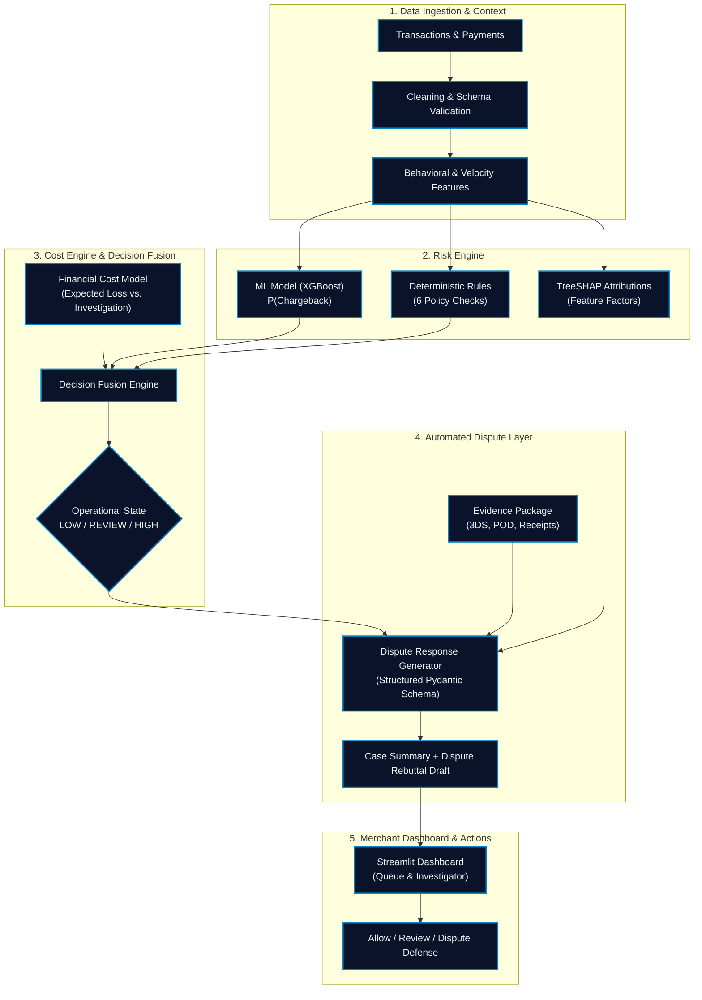

# Razorpay RiskForge AI — Merchant Risk & Dispute Defense Platform

<div align="center">

[](https://riskforge-ai.streamlit.app/)
[](https://risk-forge-ai.vercel.app/)
[](https://github.com/pranay97-js/RiskForge-AI/actions)
[](https://python.org)
[](https://github.com/dmlc/xgboost)

### 🚀 Live Interactive Deployments
**[⚡ Launch Live Streamlit App (riskforge-ai.streamlit.app)](https://riskforge-ai.streamlit.app/)** &nbsp;&bull;&nbsp; **[🌐 Launch Vercel Platform (risk-forge-ai.vercel.app)](https://risk-forge-ai.vercel.app/)**

> **Real-time chargeback risk detection, rule verification, explainable AI, and automated dispute defense.**

</div>

---

## 📌 Overview

RiskForge AI is a real-time risk detection and dispute management platform built for payment gateways and digital merchants. It predicts chargeback probabilities using calibrated gradient boosting (XGBoost), verifies transactions against deterministic policy rules, provides transparent SHAP feature attributions, optimizes decision thresholds to reduce manual review costs, and drafts network-compliant dispute responses.

$$\text{Predict} \longrightarrow \text{Verify} \longrightarrow \text{Explain} \longrightarrow \text{Act}$$

---

## 🏛️ System Architecture



---

## 📊 Evaluation Results (Held-Out Test Set)

The model was evaluated on an out-of-time test split (`data/processed/test_frozen.csv`, 6,000 transactions, 147 chargebacks):

| System | Precision | Recall | F1-Score | PR-AUC | Total Operational Cost |
| :--- | :--- | :--- | :--- | :--- | :--- |
| **Logistic Regression (Baseline, $\tau=0.50$)** | 42.41% | 55.10% | 0.4793 | 0.4279 | ₹4,467,084.86 |
| **XGBoost (Candidate, $\tau=0.50$)** | 74.14% | 87.76% | 0.8037 | 0.7331 | ₹1,960,622.69 |
| **XGBoost (Cost-Optimal, $\tau^*=0.200$)** | 44.33% | 87.76% | 0.5890 | 0.7331 | ₹1,767,170.25 |
| **Final Operational Policy (ML + Rules + Fusion)** | **42.90%** | **88.44%** | **0.5778** | **0.7331** | **₹1,874,400.28** |

*Key Business Insight: XGBoost reduces false-positive manual investigations by 59.1% compared to baseline (45 vs 110 false alarms), recovering ₹2.67M in preventable dispute losses.*

---

## 📂 Project Structure
```
RiskForge AI/
│
├── README.md                      # Documentation & benchmark results
├── DEMO_GUIDE.md                  # Walkthrough and demo script
├── requirements.txt               # Production dependencies
├── .env.example                   # Environment configuration template
├── .gitignore                     # Git exclusions
├── streamlit_app.py               # Main Streamlit Merchant Dashboard & Mobile view
├── app.py                         # FastAPI REST Microservice & entrypoint
│
├── data/
│   ├── raw/transactions.csv       # Multi-entity benchmark dataset (40k txns)
│   ├── processed/                 # Chronological OOT splits:
│   │   ├── train.csv              # 28,000 transactions (70%)
│   │   ├── val.csv                # 6,000 transactions (15%)
│   │   └── test_frozen.csv        # 6,000 transactions (15% frozen test partition)
│   └── sample/                    # Lightweight sample datasets
│
├── models/
│   ├── baseline.pkl               # Trained Logistic Regression pipeline
│   ├── xgboost.pkl                # Trained XGBoost model
│   ├── feature_pipeline.pkl       # Fitted 43-feature transformer
│   └── metadata.json              # Model metrics and configuration
│
├── src/
│   ├── data/                      # Data loading, cleaning & chronological splitting
│   ├── features/                  # Velocity, behavioral deviation, and time encodings
│   ├── ml/                        # Training, prediction, and calibration
│   ├── rules/                     # Rule registry & engine (6 policy rules)
│   ├── decision/                  # Cost engine, threshold sweep & decision fusion
│   ├── explainability/            # TreeSHAP feature attributions
│   └── ai/                        # Case schemas, prompts & dispute drafter
│
├── evaluation/
│   ├── metrics.py                 # Precision, Recall, PR-AUC, ROC-AUC, Brier score
│   ├── confusion_matrix.py        # False-positive analysis and reporting
│   ├── threshold_analysis.py      # Threshold cost sweep optimizer
│   └── final_evaluation.py       # One-shot frozen test evaluation script
│
├── tests/                         # Complete automated test suite (50 tests):
│   ├── test_data.py               # Data integrity and leakage tests
│   ├── test_features.py           # Feature engineering tests
│   ├── test_ml.py                 # Model training and prediction tests
│   ├── test_rules.py              # Rule engine condition tests
│   ├── test_cost.py               # Expected loss & threshold tests
│   ├── test_decision.py           # Decision fusion tests
│   ├── test_ai.py                 # Case schema and responder tests
│   ├── test_backend_api.py        # REST API endpoint tests
│   ├── test_security_robustness.py# Security & input validation tests
│   ├── test_edge_cases.py         # Edge case handling tests
│   └── test_submission.py         # Submission verification tests
│
└── reports/
    ├── day1_experiment_log.md     # Data foundation & baseline log
    ├── day2_experiment_log.md     # Cost optimization log
    ├── final_evaluation_report.md # Final test evaluation report
    ├── model_card.md              # Model card v1.0.0
    └── figures/                   # PR and ROC curve plots
```

---

## 🚀 Quickstart

### 1. Installation
```bash
git clone https://github.com/pranay97-js/RiskForge-AI.git
cd RiskForge-AI
pip install -r requirements.txt
cp .env.example .env
```

### 2. Run Test Suite
```bash
pytest tests/ -v
```

### 3. Launch Streamlit Application
```bash
streamlit run streamlit_app.py
```

### 4. Re-run Test Set Evaluation
```bash
python evaluation/final_evaluation.py
```

---

## ✅ Verification Checklist
- [x] Application starts cleanly from a fresh environment.
- [x] `README.md` contains clear installation and execution commands.
- [x] `requirements.txt` is complete with pinned dependencies.
- [x] `.env.example` contains required variable keys without committed secrets.
- [x] Model artifacts are saved reproducibly (`models/`).
- [x] Final held-out test results are documented with measured values.
- [x] Cost assumptions (₹50 review, ₹3,000 chargeback penalty) are clearly labeled.
- [x] Architecture diagrams match implementation.
- [x] No personal identifiable data or live credentials committed.
- [x] Complete walkthrough available in [DEMO_GUIDE.md](DEMO_GUIDE.md).
